# Awesome Claude Motion Prompts [](https://awesome.re)

**English** · [Bahasa Melayu](README.ms.md)

> Prompts we wrote for Claude that turn into short motion graphics for reels: kinetic captions, brand intros, moving charts, transitions and app demos. Each prompt is shown with the video it produced. Below them, open-source motion tools ranked by stars and recent activity, refreshed every week.

Paste a prompt into Claude as it is, then swap the words, colours and numbers for your own. Each preview was rendered with HyperFrames from code written by a new Claude session that was given the English prompt and a short note on where to save the files.

## Contents

- [Kinetic text and reel captions](#kinetic-text-and-reel-captions)
  - [Word by word caption highlight](#word-by-word-caption-highlight)
  - [Stacked headline slam](#stacked-headline-slam)
  - [Typewriter hook with marker sweep](#typewriter-hook-with-marker-sweep)
- [Brand intros and outros](#brand-intros-and-outros)
  - [Line drawn logo reveal](#line-drawn-logo-reveal)
  - [Shape burst episode intro](#shape-burst-episode-intro)
  - [Follow end card](#follow-end-card)
- [Moving charts and numbers](#moving-charts-and-numbers)
  - [Counting statistic with growth chip](#counting-statistic-with-growth-chip)
  - [Monthly bar chart that grows](#monthly-bar-chart-that-grows)
  - [Donut ring percentage](#donut-ring-percentage)
- [Transitions and backgrounds](#transitions-and-backgrounds)
  - [Diagonal band wipe](#diagonal-band-wipe)
  - [Dot grid ripple behind a chapter title](#dot-grid-ripple-behind-a-chapter-title)
- [Product and app demos](#product-and-app-demos)
  - [App tap through demo](#app-tap-through-demo)
  - [Stacked order notifications](#stacked-order-notifications)
  - [Search bar typing demo](#search-bar-typing-demo)
- [Code to video renderers](#code-to-video-renderers)
- [Web animation libraries](#web-animation-libraries)
- [Claude skills and starters](#claude-skills-and-starters)
- [No setup](#no-setup)
- [Made for you](#made-for-you)
- [How the ranking works](#how-the-ranking-works)
- [Work with Sasa Teguh](#work-with-sasa-teguh)

## Kinetic text and reel captions

### Word by word caption highlight

```text
Make a 6 second vertical video,
1080 by 1920, that shows a reel
caption timed to speech.

The sentence is: "Most people quit
one week before it starts
working."

Show three or four words at a time
in the lower third, in a bold
sans-serif system font about 88
px, white with a soft dark shadow,
on a charcoal background with a
gentle vertical gradient.

Pace it at about two and a half
words per second. The word being
spoken turns yellow and grows 10
percent with a quick ease-out,
then settles back when the next
word starts.

Each group of words rises 30 px
into place as it appears and fades
out just before the next group.

Use only HTML, CSS and system
fonts, with no images, icons or
fonts from outside.
```

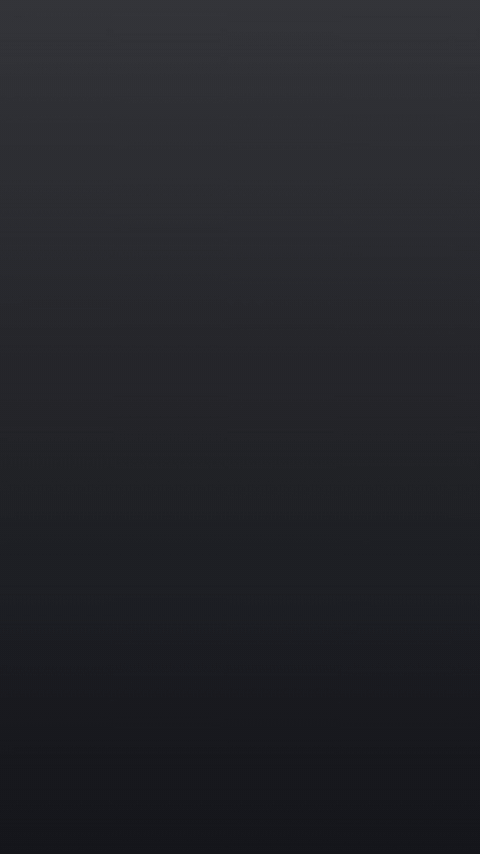

[Video (MP4)](contoh/kapsyen-sorot/hasil.mp4) · [Source](contoh/kapsyen-sorot)

### Stacked headline slam

```text
Make a 5 second vertical video,
1080 by 1920, with a three line
headline on a near-black
background.

The lines are "Stop", "posting"
and "randomly", stacked and
centred, in a heavy condensed
sans-serif system font that fills
about 80 percent of the width.

Each line slams in 0.4 seconds
after the one before: it starts at
140 percent scale and lands at 100
percent with a small overshoot.
Alternate the colours white,
orange, white.

When the last line lands, give the
whole block one short shake of a
few pixels, then hold.

In the final second, draw an
orange underline from left to
right under "randomly".

Use only HTML, CSS and system
fonts, with no images, icons or
fonts from outside.
```

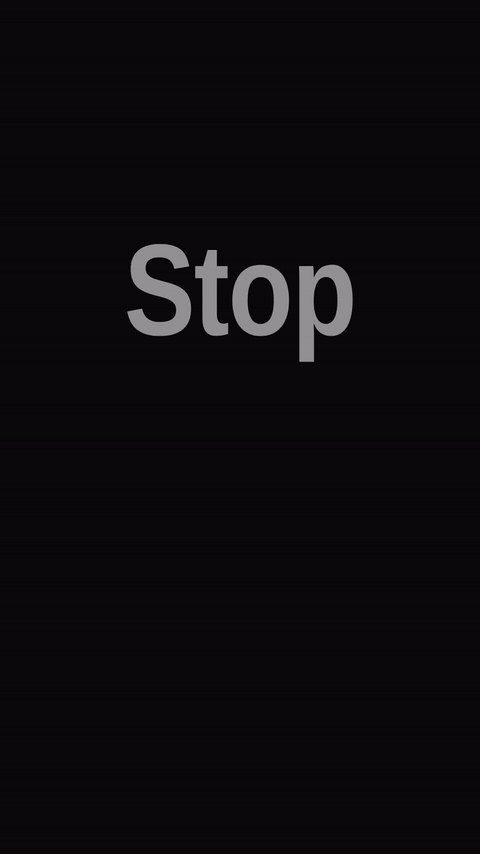

[Video (MP4)](contoh/tajuk-hentak/hasil.mp4) · [Source](contoh/tajuk-hentak)

### Typewriter hook with marker sweep

```text
Make a 6 second vertical video,
1080 by 1920, that types an
opening hook on a warm cream
background.

Type "Here is what nobody tells
you about saving money" letter by
letter at a steady pace in a
monospace system font, dark brown,
about 72 px, wrapped across three
or four centred lines, with a
blinking text cursor at the end.

When the typing finishes, sweep a
translucent yellow marker
highlight from left to right
behind the words "nobody tells
you", as if drawn by hand,
slightly uneven at the edges.

Hold the finished frame for the
last second while the cursor keeps
blinking.

Use only HTML, CSS and system
fonts, with no images, icons or
fonts from outside.
```

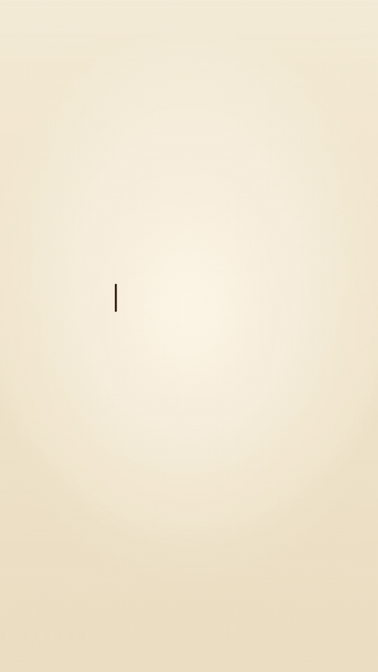

[Video (MP4)](contoh/mesin-taip-sorot/hasil.mp4) · [Source](contoh/mesin-taip-sorot)

## Brand intros and outros

### Line drawn logo reveal

```text
Make a 5 second vertical video,
1080 by 1920, that reveals a logo
for a made-up coffee shop called
"Kopi Senja".

Build the logo as inline SVG: a
circle with a simple coffee cup
outline inside it and two curved
steam lines above the cup.

For the first 1.5 seconds, draw
every stroke as if with a pen,
using an animated stroke dash
offset, in a warm brown on an
off-white background.

Then fill the circle with deep
orange and turn the strokes cream,
over 0.4 seconds.

After that, fade the name "Kopi
Senja" up letter by letter beneath
the logo in a serif system font,
followed by the smaller line
"Since 2019".

Use only HTML, CSS, inline SVG and
system fonts, with no images,
icons or fonts from outside.
```

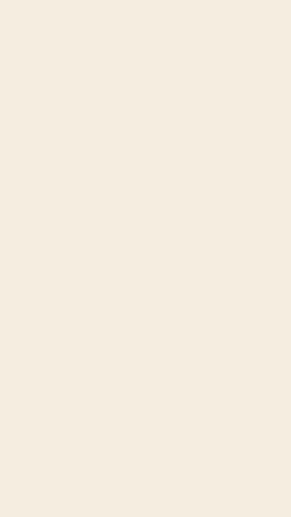

[Video (MP4)](contoh/logo-garis/hasil.mp4) · [Source](contoh/logo-garis)

### Shape burst episode intro

```text
Make a 5 second vertical video,
1080 by 1920, for the opening of a
short series episode.

Start with an empty dark navy
screen. At 0.2 seconds, about
twenty small shapes (circles,
squares and triangles in coral,
mint and sand) burst outward from
the centre, spinning as they
travel and slowing down with an
ease-out.

At 1.8 seconds, pull the shapes
back to the centre where they
merge into one rounded rectangle
in coral.

Inside the rectangle, slide up the
text "Episode 12" in small letters
and "Pricing your first product"
in a large bold sans-serif system
font, white.

Hold the title card for the final
second.

Use only HTML, CSS and system
fonts, with no images, icons or
fonts from outside.
```


[Video (MP4)](contoh/pembuka-bentuk/hasil.mp4) · [Source](contoh/pembuka-bentuk)

### Follow end card

```text
Make a 6 second vertical video,
1080 by 1920, that works as the
closing card of a reel.

On a soft lilac background, scale
in a circle 280 px wide in deep
purple with the initials "NA" in
white, then slide in the name
"Nadia Aziz" and the handle
"@yourhandle" below it.

At 2 seconds, pop up a rounded
pill button that says "Follow for
part 2", white text on deep
purple.

Pulse the button twice, gently,
and draw a curved arrow that
points at it from the side.

For the last second, fade in a
small line at the bottom: "New
videos every Tuesday".

Use only HTML, CSS, inline SVG and
system fonts, with no images,
icons or fonts from outside.
```


[Video (MP4)](contoh/kad-penutup/hasil.mp4) · [Source](contoh/kad-penutup)

## Moving charts and numbers

### Counting statistic with growth chip

```text
Make a 5 second vertical video,
1080 by 1920, that presents one
statistic on a deep green
background.

In the centre, count a large
number from 0 to 12,480 over 2
seconds with an ease-out, using a
thousands separator and tabular
digits so the width does not jump,
in a bold sans-serif system font
about 180 px, white.

As the count finishes, fade in the
label "followers in 30 days"
underneath.

Then slide in a small rounded chip
from the right that reads "+38%"
with an upward triangle, in light
green.

Treat every number as a
placeholder the viewer will
replace.

Use only HTML, CSS and system
fonts, with no images, icons or
fonts from outside.
```

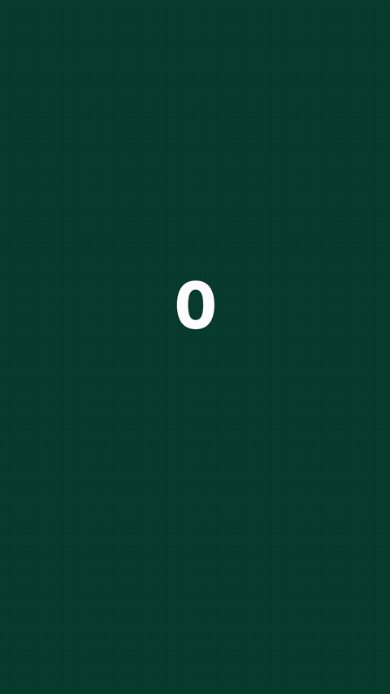

[Video (MP4)](contoh/kaunter-statistik/hasil.mp4) · [Source](contoh/kaunter-statistik)

### Monthly bar chart that grows

```text
Make a 6 second vertical video,
1080 by 1920, with a four bar
chart of monthly sales on an
off-white background.

Title at the top: "Sales, January
to April", dark grey, bold
sans-serif system font.

The bars are January 12k, February
18k, March 9k and April 27k, in a
muted blue with rounded tops,
labelled with the month
underneath.

Grow the bars from zero one after
another, 0.35 seconds apart, each
with a slight overshoot, while the
value above each bar counts up
with it.

When all four are up, turn the
April bar coral and fade in a
short note above it: "+50% on
February".

Keep every label and the note
fully inside the frame, at least
60 px from each edge.

Use only HTML, CSS and system
fonts, with no images, icons or
fonts from outside.
```

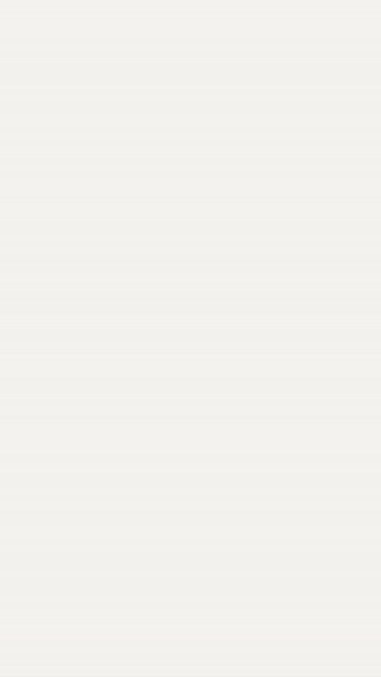

[Video (MP4)](contoh/carta-bar/hasil.mp4) · [Source](contoh/carta-bar)

### Donut ring percentage

```text
Make a 5 second vertical video,
1080 by 1920, built around one
percentage on a dark slate
background.

Draw a donut ring 600 px wide with
a thick grey track. Over 2
seconds, fill the ring clockwise
from the top to 73 percent in
teal, with an ease-in-out, while
the number in the middle counts
from 0 to 73 with a percent sign.

After the ring stops, fade in a
two line caption below it: "of
buyers read reviews" and, smaller,
"before they pay".

Finish with a small glow pulse on
the end of the teal arc.

Treat the numbers and text as
placeholders.

Use only HTML, CSS, inline SVG and
system fonts, with no images,
icons or fonts from outside.
```

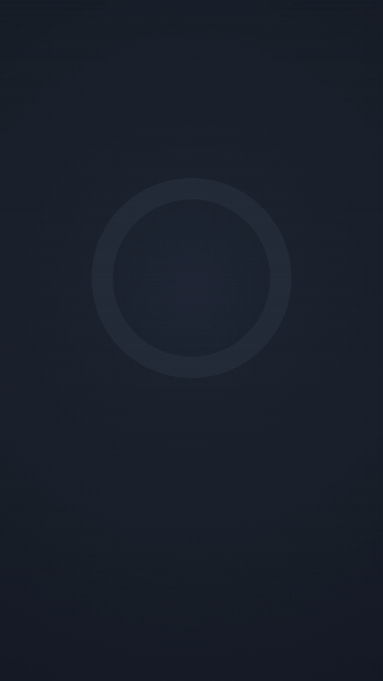

[Video (MP4)](contoh/donat-peratus/hasil.mp4) · [Source](contoh/donat-peratus)

## Transitions and backgrounds

### Diagonal band wipe

```text
Make a 4 second vertical video,
1080 by 1920, that moves between
two title cards with a diagonal
wipe.

Card one: a grey background with
the word "Before" in large dark
text. Card two: a teal background
with the word "After" in large
white text, bold sans-serif system
font.

Show card one for 1.5 seconds.
Then sweep three wide parallel
bands (yellow, coral, then teal)
diagonally across the frame from
bottom left to top right, each
starting 0.08 seconds after the
last, each crossing in about 0.6
seconds with an ease-in-out.

The last band leaves card two
behind it. Hold card two to the
end.

Use only HTML, CSS and system
fonts, with no images, icons or
fonts from outside.
```

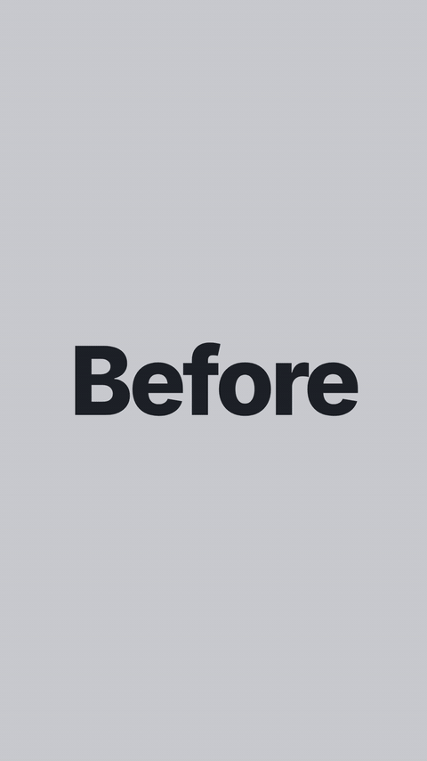

[Video (MP4)](contoh/sapuan-pepenjuru/hasil.mp4) · [Source](contoh/sapuan-pepenjuru)

### Dot grid ripple behind a chapter title

```text
Make a 6 second vertical video,
1080 by 1920, with a chapter title
over a moving dot grid.

Fill the frame with a grid of
small dots, 12 across and 21 down,
in a muted blue on a very dark
blue background.

Send a ripple through the grid
from the bottom left corner: each
dot grows and brightens as the
wave reaches it, then shrinks
back, with the delay based on its
distance from the corner. Run two
waves, 2.5 seconds apart.

At 1 second, fade in "Chapter 2"
in small spaced capitals and
"Getting your first ten customers"
in a large bold sans-serif system
font, white, centred over the
grid.

Use only HTML, CSS and system
fonts, with no images, icons or
fonts from outside.
```

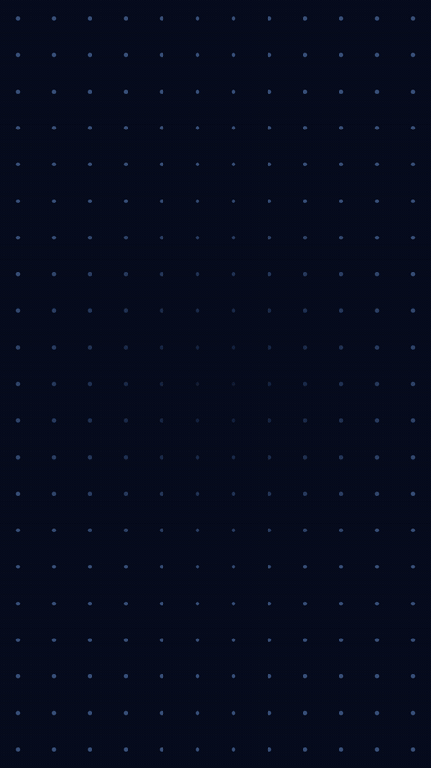

[Video (MP4)](contoh/grid-titik/hasil.mp4) · [Source](contoh/grid-titik)

## Product and app demos

### App tap through demo

```text
Make a 6 second vertical video,
1080 by 1920, that demonstrates
one action in a simple to-do app.

In the centre, draw a phone
outline with CSS: a rounded
rectangle about 760 by 1560 px
with a dark bezel. Inside it, show
a light app screen titled "Today"
with two existing tasks.

At 1 second, a round translucent
touch marker glides to an "Add
task" button at the bottom and
taps it, with a short ripple.

A new task row, "Send the quote to
Aina", slides in at the top of the
list and pushes the others down.

At 4 seconds, the marker taps the
new row's checkbox: the box fills
green, a tick draws itself, and
the text gets a line through it.

Use only HTML, CSS, inline SVG and
system fonts, with no images,
icons or fonts from outside.
```

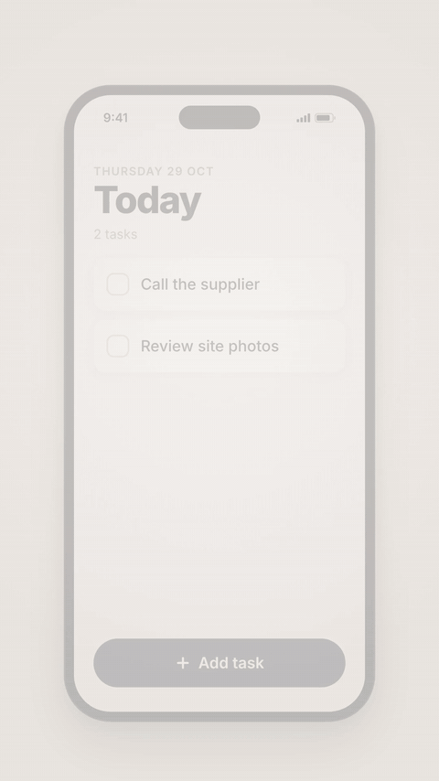

[Video (MP4)](contoh/demo-ketik/hasil.mp4) · [Source](contoh/demo-ketik)

### Stacked order notifications

```text
Make a 5 second vertical video,
1080 by 1920, that shows a small
shop's good morning as phone
notifications.

On a blurred-looking lock screen
made from a soft blue to violet
gradient, show the time "9:41" at
the top in a large thin system
font.

Drop three notification cards from
the top, one every 0.9 seconds:
"New order #1042", "Payment
received RM 89.00" and "Order
#1042 shipped".

Each card is solid white, rounded,
with a small coloured square as
the app mark and a "now"
timestamp. As a new card arrives,
the older cards slide down and
shrink slightly behind it, so only
a thin strip of each one shows
below the newest card, like a real
stack.

Use only HTML, CSS and system
fonts, with no images, icons or
fonts from outside.
```

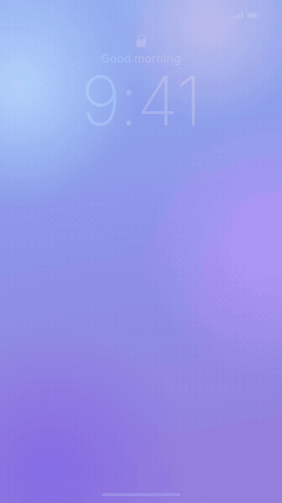

[Video (MP4)](contoh/notifikasi-bertindan/hasil.mp4) · [Source](contoh/notifikasi-bertindan)

### Search bar typing demo

```text
Make a 6 second vertical video,
1080 by 1920, that shows someone
searching in a simple app.

Near the top of a white screen,
draw a rounded search bar with a
magnifier made from CSS or inline
SVG.

Type "nasi lemak near me" into the
bar, one letter at a time, with a
blinking cursor.

After the third word, open a
dropdown of three suggestions
under the bar; the second one,
"nasi lemak near me open now",
highlights as if hovered and is
then chosen.

The dropdown closes and three
result cards slide up from the
bottom one after another, each
with a coloured square
placeholder, a shop name, a star
rating drawn with text and a
distance such as "0.8 km".

Use only HTML, CSS, inline SVG and
system fonts, with no images,
icons or fonts from outside.
```

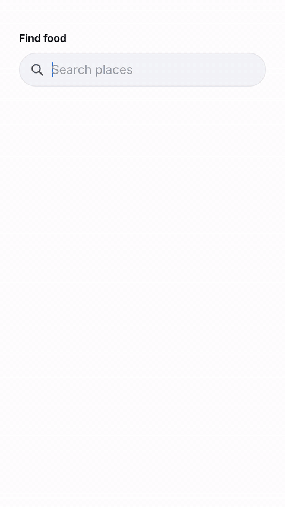

[Video (MP4)](contoh/carian-taip/hasil.mp4) · [Source](contoh/carian-taip)

## Code to video renderers

- [heygen-com/hyperframes](https://github.com/heygen-com/hyperframes) - ★ 75.9k+ · Apache-2.0 · 2026-10 — Write HTML. Render video. Built for agents.
- [3b1b/manim](https://github.com/3b1b/manim) - ★ 95.9k+ · MIT · 2026-09 — Animation engine for explanatory math videos.
- [remotion-dev/remotion](https://github.com/remotion-dev/remotion) - ★ 69k+ · other license · 2026-10 — 🎥 Make videos programmatically with React.
- [ManimCommunity/manim](https://github.com/ManimCommunity/manim) - ★ 42k+ · MIT · 2026-10 — A community-maintained Python framework for creating mathematical animations.
- [motion-canvas/motion-canvas](https://github.com/motion-canvas/motion-canvas) - ★ 19.5k+ · MIT · 2026-07 — Visualize Your Ideas With Code.
- [dmtrKovalenko/fframes](https://github.com/dmtrKovalenko/fframes) - ★ 3k+ · MIT · 2026-10 — programmatic video rendering framework that is actually fast.
- [midrender/revideo](https://github.com/midrender/revideo) - ★ 4.1k+ · MIT · 2026-07 — Create Videos with Code.
- [nexu-io/html-video](https://github.com/nexu-io/html-video) - ★ 4.7k+ · Apache-2.0 · 2026-06 — Programmatic video for coding agents — HTML to video on your laptop. Turn HTML, CSS & data into real MP4s with pluggable render engines, 21 templates, AI soundtrack. Apache-2.0, no per-render fees. An official project by the Open Design team.
- [BintzGavin/helios](https://github.com/BintzGavin/helios) - ★ 120+ · Apache-2.0 · 2026-10 — Programmatic video creation with web technologies you already know. CSS animations just work.

## Web animation libraries

- [juliangarnier/anime](https://github.com/juliangarnier/anime) - ★ 74k+ · MIT · 2026-08 — JavaScript animation engine.
- [motiondivision/motion](https://github.com/motiondivision/motion) - ★ 34.6k+ · MIT · 2026-10 — A modern animation library for React and JavaScript.
- [mojs/mojs](https://github.com/mojs/mojs) - ★ 18.8k+ · MIT · 2026-07 — The motion graphics toolbelt for the web.

## Claude skills and starters

- [latent-spaces/brag](https://github.com/latent-spaces/brag) - ★ 19.6k+ · MIT · 2026-10 — You built it. Now brag. Turn the project you just created into a short, shareable launch video with one command.
- [Vincentwei1021/video-shotcraft](https://github.com/Vincentwei1021/video-shotcraft) - ★ 15.1k+ · Apache-2.0 · 2026-10 — AI video skill for Claude Code & Codex — cinematic, editable product promos with Remotion: 124 shot recipe cards, 150 motion previews, beat sync, sound design, Motion Workbench & JianYing (CapCut CN) export.
- [digitalsamba/claude-code-video-toolkit](https://github.com/digitalsamba/claude-code-video-toolkit) - ★ 2.3k+ · MIT · 2026-10 — AI-native video production toolkit for Claude Code.
- [LottieFiles/motion-design-skill](https://github.com/LottieFiles/motion-design-skill) - ★ 2.6k+ · MIT · 2026-05 — Universal motion design principles for AI agents — timing, easing, choreography, and Disney animation principles adapted for UI.
- [haidrrrry/claude-remotion-skill](https://github.com/haidrrrry/claude-remotion-skill) - ★ 730 · MIT · 2026-08 — Open-source Claude agent skill that teaches Claude Code, Claude Desktop & Claude AI to create and edit professional motion graphics videos with Remotion. AI video editing, B-roll, captions, sound design — from one prompt.
- [Sunwood-ai-labs/hyperframes-motion-reel-skill](https://github.com/Sunwood-ai-labs/hyperframes-motion-reel-skill) - ★ 160 · MIT · 2026-09 — 🎬 Claude Code skill for showreel-grade, beat-synced motion graphics with HyperFrames (HTML + GSAP + SVG + Canvas, Apache-2.0) — 120 BPM / 60 FPS to MP4.
- [jhartquist/claude-remotion-kickstart](https://github.com/jhartquist/claude-remotion-kickstart) - ★ 120+ · MIT · 2025-12 — Create videos programmatically with Claude Code and Remotion.

## No setup

[Cutt](https://cutt.my/en) is a Claude connector that edits 9:16 talking-head videos inside Claude: upload a video, name a style, and Claude adds B-roll, icons and kinetic type that follow your words. Cutt is made by Sasa Teguh, the maintainer of this list.

## Made for you

If you would rather have a motion piece made for you, [contact Sasa Teguh](https://sasateguh.com/contact), the team that maintains this list.

## How the ranking works

Every entry is a public GitHub repository. Each week a script reads its stars, last push and license from the GitHub API and sorts each category by

`score = 1 × log10(1 + stars) + 1 × max(0, 1 − days since last push ÷ 365)`

A repository is left out when it is archived, a fork, has no description, has fewer than 50 stars or has not been pushed for 365 days. Star counts are rounded down to the nearest 10. Descriptions are the repositories' own GitHub descriptions.

## Work with Sasa Teguh

[](https://sasateguh.com/book)

This list is maintained by [Sasa Teguh](https://sasateguh.com), a studio in Malaysia. We build websites that are found on Google and in AI answers, and we set up systems for businesses.

hello@sasateguh.com · [More from Sasa Teguh](https://github.com/sasateguh)

## Contributing

Suggestions are welcome. See [contributing.md](contributing.md).
